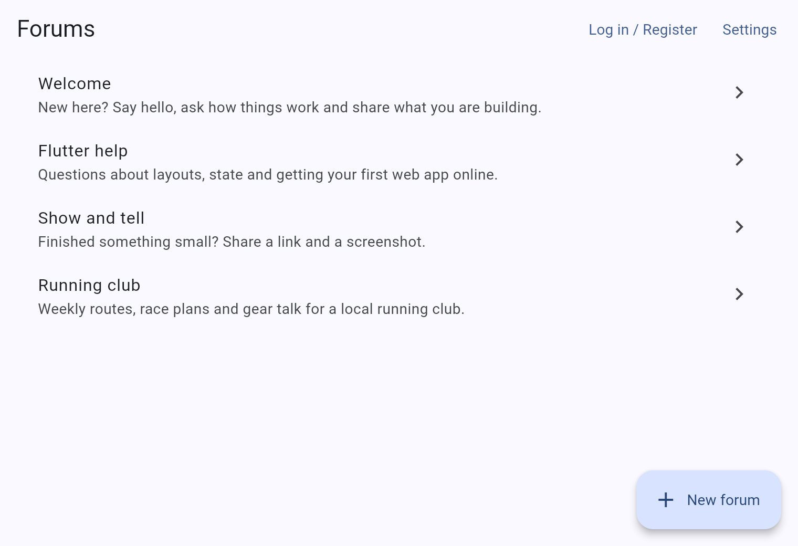

# SimpleAPI Forums API: Flutter web sample

A small Flutter web app that shows how to call the free [SimpleAPI Forums API](https://forums.simpleapi.dev/docs) from a browser, with no backend of your own.

**[Live demo](https://simple-api-dev.github.io/forums-client/)** | **[API docs](https://forums.simpleapi.dev/docs)** | **[Get a free key](https://keys.simpleapi.dev/?product=forums)**



## Run it

You need the [Flutter SDK](https://docs.flutter.dev/get-started/install) (stable; CI uses 3.47.8).

```bash
git clone https://github.com/simple-api-dev/forums-client
cd forums-client
flutter pub get
flutter run -d chrome --dart-define=SIMPLEAPI_KEY=YOUR_KEY
```

Leave `--dart-define` out and paste your key under Settings instead. Get a free key at https://keys.simpleapi.dev/?product=forums.

The checks the workflow runs. All HTTP is mocked, so nothing calls the real API:

```bash
flutter analyze
flutter test
```

## How it calls the API

Every call goes through [`lib/forums_api.dart`](lib/forums_api.dart). The key goes in the `apikey` query string. Calls that write also send the login token as a Bearer header:

```
GET  https://forums.simpleapi.dev/api/forums?apikey=YOUR_KEY
POST https://forums.simpleapi.dev/api/users/login?apikey=YOUR_KEY
POST https://forums.simpleapi.dev/api/forums?apikey=YOUR_KEY
Authorization: Bearer <token from login or register>
```

Reading needs only the key. Writing (forums, topics, comments, votes, reports) also needs a logged-in user, whom you can register inside the app. Users belong to your key, and the API uses the logged-in user as the author, so the client never sends one. Login and register never send the token. If a call made while logged in is answered with a 401 about the token, the app drops it and opens the login screen.

## Screens and API calls

| Screen | What it does | Calls |
| --- | --- | --- |
| **Forums** (`forums_screen.dart`) | The landing screen. Lists the forums of the key, or an empty state. **New forum** asks you to log in first. | `GET /api/forums`, `POST /api/forums` |
| **Settings** (`settings_screen.dart`) | Use your own key instead of the shared demo key, or remove it again. | `GET /api/forums` (used to check the key) |
| **Log in / Register** (`auth_screen.dart`) | Get a token. Opened when you try to write or vote. **Log out** is in the app bar. | `POST /api/users/register`, `POST /api/users/login`, `POST /api/users/logout` |
| **Forum** (`forum_screen.dart`) | The topics of one forum, start a topic, and delete the forum if you made it. | `GET /api/forums/{slug}/topics`, `POST /api/forums/{id}/topics`, `DELETE /api/forums/{id}` |
| **Topic** (`topic_screen.dart`) | A topic with its whole comment tree, with replies indented. Comment, reply, vote, edit and delete your own, and report anything. | `GET /api/topics/{slug}`, `POST /api/comments/type/topic/{id}`, `POST /api/comments/type/comment/{id}`, `PUT /api/topics/{id}`, `PUT /api/comments/{id}`, `DELETE /api/topics/{id}`, `DELETE /api/comments/{id}`, `POST /api/votes/up/{type}/{id}`, `POST /api/votes/down/{type}/{id}`, `DELETE /api/votes/{type}/{id}`, `POST /api/reports/type/{type}/{id}` |

Not in this sample: moderator tools, rules, tags, search, and the admin flows. See the [full docs](https://forums.simpleapi.dev/docs).

## Keys

The live demo opens straight on the forum list because a shared demo key is built into it. Demo accounts are shared and public, so do not use a real password.

To use your own key, open **Settings**, paste it and save. It is checked with one call, kept only in your browser (localStorage) and sent only to `forums.simpleapi.dev`. **Remove my key** goes back to the demo key.

A free key holds 25 users and 7 forums, 300 topics and 2000 comments. When the shared demo key is full, register answers with a message that says so.

## Good to know

- Writes send `status: Active`. Topic `type` is `Post`, `Video`, `Article` or `Image`. Topic `body` is optional.
- A vote needs no body. It answers `{"points": <integer>}`, the new total score. `DELETE /api/votes/{type}/{id}` takes a vote back.
- Report types are `Noncompliant`, `Offensive` and `Other`. The sample offers the last two.
- A reported topic or comment shows a "pending moderation" text until the report is resolved.
- Logging in again invalidates the earlier token.
- Errors are `{"message": "..."}`: wrong login `401`, duplicate email `409`, malformed JSON `400`, validation `422`, rate limit `429`. The limit is 60 requests a minute per IP address.
- Registering the email your key belongs to answers `202` and emails a code. The sample shows the message but does not implement that confirm step, so use another address.

## Project layout

```
lib/forums_api.dart       the whole API client
lib/models.dart           response classes
lib/app_state.dart        saved key and logged-in user (a ChangeNotifier)
lib/key_store*.dart       localStorage wrapper, plus an in-memory one for tests
lib/open_url*.dart        opens a link in a new tab
lib/config.dart           the build-time key (SIMPLEAPI_KEY)
lib/screens/              the screens, and ui.dart with the shared widgets and error wording
test/                     unit tests for the client, widget tests for the app
```

## Deploy to GitHub Pages

[`.github/workflows/pages.yml`](.github/workflows/pages.yml) runs on every push to `main`. It installs Flutter, runs `flutter analyze` and `flutter test`, builds with `flutter build web --release --base-href /forums-client/`, and publishes with the official Pages actions.

In your own copy:

1. Set **Settings, Pages, Source** to **GitHub Actions**.
2. Add a repository **variable** named `SIMPLEAPI_KEY` under **Settings, Secrets and variables, Actions, Variables**. The build passes it with `--dart-define=SIMPLEAPI_KEY=...`. If it is empty, the app shows "This demo has no key configured".
3. Push to `main`, or run the workflow.

Anything passed with `--dart-define` ends up in the compiled JavaScript, so anyone can read it from the deployed site. Use a free key made for a public demo. If you rename the repository, change `--base-href` to match.

## License

[MIT](LICENSE)
